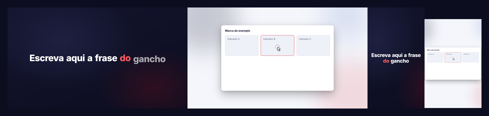
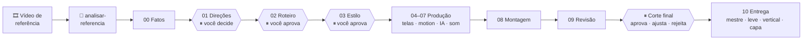

<div align="center">

# 🎬 Agentes Video Lab

**Mande um vídeo de referência. Receba um vídeo de produto no mesmo estilo, feito por um agente de código.**

Motion em código com Remotion · telas reais do produto · cenas de IA · som · versão vertical de verdade · você decide nas paradas que importam.




<sub>Tudo acima foi renderizado pelo próprio motor (`motor/`), a partir de uma única composição.</sub>

</div>

---

## ✨ O que é

Um **kit** para produzir vídeos de produto (lançamentos, demos, anúncios) conduzidos por um agente de código, com método:

- 🔎 **Parte de uma referência.** Você dá um vídeo de que gostou; o kit mede o ritmo, os cortes, o volume, a paleta e a fala, e o agente lê o *molde* dele.
- 🧭 **Fluxo com paradas.** O agente conduz; **você decide** a direção, o roteiro, o estilo e o corte final. Nenhum crédito é gasto sem o seu ok.
- 🧱 **Motor genérico.** Remotion com tema por arquivo (`marca.json`), texto cinético, cursor, câmera, legendas e fundos prontos.
- 📱 **Vertical de verdade.** Não é uma faixa no meio da tela: a mesma composição é filmada por uma câmera que segue a ação.
- ✅ **Entrega conferida.** Mestre H.264, −14 LUFS, BT.709, versão leve, capa e checagem técnica por script.
- 🔒 **Seu material fica com você.** Fatos da empresa, mídia, prévias e gastos ficam em `projetos/`, fora do git.

## 🗺️ Como funciona



## 🚀 Começando em 5 minutos

### 1. Instale o que precisa

| Ferramenta | Para quê | Instalação |
|---|---|---|
| **Node 22+** | Remotion | [nodejs.org](https://nodejs.org) |
| **ffmpeg completo** | analisar, exportar e checar vídeo | Windows `winget install -e --id Gyan.FFmpeg` · Mac `brew install ffmpeg` · Linux `apt install ffmpeg` |
| **Python 3.10+** | as ferramentas (só biblioteca padrão) | [python.org](https://python.org) |
| **Claude Code** | o agente que produz | [claude.com/claude-code](https://claude.com/claude-code) |
| *opcional* `faster-whisper` | transcrever fala e medir palavras por segundo | `pip install faster-whisper` |
| *opcional* gerador de IA | voz, música, imagem e vídeo gerados | sempre com o **ok antes de gastar** |

> O ffmpeg que vem dentro do Remotion é reduzido e não serve para as ferramentas. Se o seu não estiver no PATH: `export FFMPEG=/caminho/ffmpeg` (PowerShell: `$env:FFMPEG="C:\...\ffmpeg.exe"`).

### 2. Crie o projeto
```bash
git clone https://github.com/HelenaCarrano/Agentes-video-lab.git && cd Agentes-video-lab
python ferramentas/novo-video.py meu-video
cd projetos/meu-video/motion && npm install
```

### 3. Dê uma referência e gere a análise
Ponha o vídeo que você quer imitar em `projetos/meu-video/referencias/` e rode:
```bash
python ferramentas/analisar-referencia.py projetos/meu-video/referencias/ref.mp4 \
       --saida projetos/meu-video/referencias/ref-analise
```

| Saída | O que traz |
|---|---|
| `analise.md` | duração, formato, nº de cortes e cena média, volume (LUFS) e pico, quadros pretos e parados, paleta dominante e, com `faster-whisper`, a fala e o ritmo em palavras/s |
| `folha.png` | 30 quadros do vídeo em uma imagem só (comece por ela) |
| `abertura.png` · `fechamento.png` | os 3 primeiros e os 3 últimos segundos |
| `cortes.png` | o primeiro quadro de cada cena |
| `cortes.json` | tempos dos cortes, para usar em scripts |

O agente lê a folha e preenche a **Leitura** do `analise.md`: molde (metáfora, carrossel ou história), gancho, virada para o produto, blocos, texto na tela, passagens e cartela. É isso que vira o roteiro. → [`guia/03-referencias.md`](guia/03-referencias.md)

### 4. Chame o agente
```bash
cd projetos/meu-video && claude
```
> Leia `../../guia/02-regras.md` e `../../guia/01-fluxo.md`. Quero um vídeo do produto **\<nome\>** no estilo de `referencias/ref-analise/analise.md`. Comece pelo passo 0 (fatos) e pare onde o guia mandar.

Ele conduz o fluxo e **para nas quatro decisões suas**. Você pede ajustes em linguagem normal; ele aplica e mostra de novo.

### 5. Exporte e confira
```bash
python ferramentas/exportar.py render-bruto.mp4 projetos/meu-video/entrega \
       --nome meu-video --vertical render-vertical.mp4
python ferramentas/verificar-entrega.py projetos/meu-video/entrega/meu-video-mestre.mp4
```

```text
OK       duração 70.5 s
OK       quadro 1920x1080
OK       cor BT.709 marcada
OK       volume -14.0 LUFS (alvo −14 ±1)
OK       pico -1.8 dBFS (limite −1)
OK       faststart (começa a tocar antes de baixar tudo)
Tudo certo.
```

## 📱 Versão vertical (9:16) de verdade

```tsx
<Camera origem={{ w: 1920, h: 1080 }} destino={{ w: 1080, h: 1920 }}
        keyframes={[[0, 960, 540, 1], [150, 960, 520, 0.88], [200, 960, 420, 0.88]]}>
  <FormatoVertical.Provider value={true}>
    <MinhaComposicao />
  </FormatoVertical.Provider>
</Camera>
```

1. A composição horizontal aprovada **não muda**.
2. Uma câmera (`pecas/Camera.tsx`) a filma e vai para onde a ação está em cada cena.
3. Cenas que não funcionam estreitas leem `useVertical()` e se reorganizam só nesse modo.
4. Faixa de cima: a marca. Faixa de baixo: legendas grandes (`pecas/Legendas.tsx`). Áreas seguras de Reels/Shorts/Stories respeitadas.

Como a interface é desenhada em código (vetor), ela sai nítida mesmo ampliada. Veja `ExemploVertical` em `npm run dev`. → [`guia/04-producao.md`](guia/04-producao.md)

## 🧰 O que tem dentro

```
.
├── guia/            fluxo, regras, como usar uma referência, produção, prompts dos subagentes, ffmpeg
├── modelo/          documentos em branco: fatos, direções, roteiro, estado, pedidos, decisões, gastos, licenças
├── motor/           Remotion base
│   └── src/
│       ├── marca.json          ← cores e fonte da sua marca (único lugar)
│       ├── tema.ts             tokens, curvas de animação
│       ├── Exemplo.tsx         composição de partida (horizontal e vertical)
│       └── pecas/              TextoCinetico · Cursor · Camera · Legendas · Fundos
├── ferramentas/     scripts em Python
└── projetos/        ← seus vídeos (fora do git)
```

<details>
<summary><b>🔧 Ferramentas</b></summary>

| Script | O que faz |
|---|---|
| `novo-video.py <nome>` | cria `projetos/<nome>/` com o modelo, as pastas e uma cópia do motor |
| `analisar-referencia.py <video>` | mede e fotografa um vídeo de referência |
| `exportar.py <render> <pasta>` | mestre (CRF 17, −14 LUFS, BT.709, faststart), leve 720p, capa e vertical |
| `verificar-entrega.py <video>` | revisão técnica com OK/ATENÇÃO por item |
| `srt-para-json.py <srt> <json>` | legendas em quadros para o componente `Legendas` |
| `envelope-voz.py` | energia da voz por quadro, para uma onda que reage à fala |
| `musica-compassos.py` | acha compassos "gêmeos" para emendar música sem pulo |

</details>

<details>
<summary><b>📏 As regras que não mudam</b></summary>

1. As paradas são de quem aprova. O agente nunca escolhe por ela/ele.
2. Nenhum crédito sem o ok: modelo, duração e custo antes de gerar; tudo vai para `gastos.md`.
3. A tela vem do produto real; a IA não desenha interface, logo ou número.
4. Só fatos com fonte; o que falta vira `[[CONFIRMAR]]`.
5. Nada de dado real na tela.
6. O agente confere por quadros, folhas e medidas, e diz o que não consegue avaliar (ritmo, música, voz).
7. Nada se sobrescreve; o refeito vai para `anteriores/`.
8. Duas tentativas e chama a pessoa. Poucas perguntas, cada uma com sugestão.
9. Voz de pessoa real só com autorização clara. Versão aprovada fica congelada.
10. Nunca `git push` feito pelo agente sem pedido explícito.

Lista completa em [`guia/02-regras.md`](guia/02-regras.md).

</details>

<details>
<summary><b>🎯 Números-alvo de partida</b></summary>

| Item | Alvo |
|---|---|
| Quadro | 1920×1080, 30 q/s |
| Duração | curto 20–35 s · médio 45–60 s · longo 60–95 s |
| Narração | ~2,0–2,4 palavras/s em português (meça a voz real) |
| Algo novo na tela | a cada 2–3 s |
| Texto na tela | 2–6 palavras por linha, uma destacada |
| Volume | −14 LUFS, pico ≤ −1 dBTP, música ~10 dB abaixo da voz |
| Cor | BT.709 marcado no arquivo |

A análise da sua referência diz onde ajustar.

</details>

## 🔐 O que não vai para o repositório

Tudo que é de um vídeo: `projetos/`, mídia (`.mp4`, `.wav`, `.mp3`, `.srt`), `node_modules`, renders (`out/`) e segredos (`.env`). Está no `.gitignore`. Só entram o guia, o modelo, o motor e as ferramentas.

## 🤝 Contribuindo

Melhorou uma peça do motor, uma ferramenta ou o guia? Mantenha tudo **genérico**: cores vindas de `marca.json`, nenhum nome de empresa ou dado de cliente no código. Abra um PR descrevendo o que mudou e como testou.

## 📄 Licenças e avisos

- **Remotion** é gratuito para pessoas e times pequenos; empresas maiores precisam de licença. Confira em [remotion.dev/license](https://www.remotion.dev/license) antes de usar comercialmente.
- Música, vozes, imagens e fontes têm licenças próprias: registre cada uma em `licencas.md` do projeto.
- Ao usar logos de outras marcas ou conteúdo gerado por IA, confira os termos da plataforma onde o vídeo vai ser publicado.
