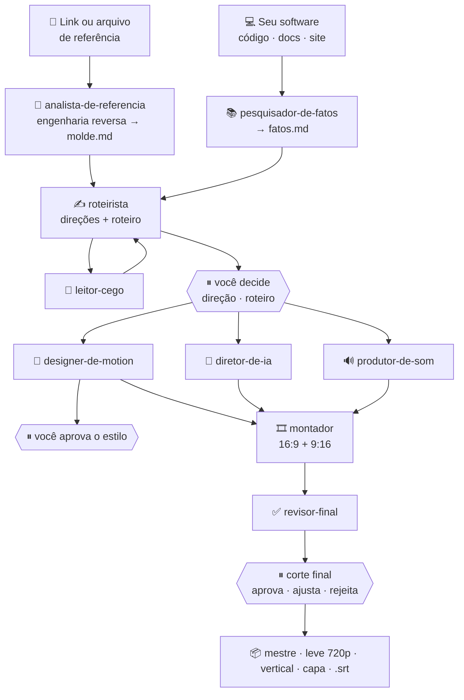

<div align="center">

# 🎬 Agentes Video Lab

### Um gerador de vídeo para o seu software, feito por uma equipe de agentes.

**Cole o link de um vídeo de que você gostou. Os agentes fazem a engenharia reversa dele, leem o seu produto, escrevem o roteiro e montam o seu vídeo no mesmo estilo.**

*A video generator for your software, powered by a team of AI agents: reverse-engineer any reference video from a link, generate the script, and produce the final cut.*


<sub>Renderizado pelo próprio motor (`motor/`): uma composição, dois formatos.</sub>

</div>

---

## ✨ Três ideias

| | |
|---|---|
| 🔎 **Engenharia reversa de referência** | Dê um **link** (YouTube, Vimeo, link direto) ou um arquivo. O kit baixa, mede ritmo, cortes, volume, paleta e fala, e um agente lê os quadros e escreve o **molde**: estrutura, gancho, virada para o produto, passagens, cartela e alvos numéricos. |
| ✍️ **Geração de roteiro** | O roteirista cruza o **molde** da referência com os **fatos** do seu software (lidos do código, da documentação e do site, cada um com fonte) e escreve três direções e o roteiro por batida, com a duração calculada pela voz. Um leitor cego testa se ele se entende sem contexto. |
| 🧑‍🤝‍🧑 **Uma equipe, cada um com a sua parte** | Nove agentes especializados, coordenados por um diretor. Cada um tem entrada, saída e regras próprias; só o diretor fala com você e só ele gasta crédito, **com o seu ok**. |

## 🧑‍🤝‍🧑 A equipe

| Agente | Responsabilidade | Entrega |
|---|---|---|
| 🎯 **diretor** *(agente principal)* | conversa com você, coordena a equipe, para nas decisões, registra estado, pedidos e gastos | `estado.md`, `pedidos.md`, `gastos.md` |
| 🔎 `analista-de-referencia` | engenharia reversa do vídeo de referência | `analise.md`, `molde.md` |
| 📚 `pesquisador-de-fatos` | a verdade sobre o seu software, com fonte | `fatos.md` |
| ✍️ `roteirista` | direções, roteiro e storyboard | `direcoes.md`, `roteiro.md` |
| 🙈 `leitor-cego` | lê o roteiro sem contexto e diz onde se perdeu | resposta curta |
| 🎨 `designer-de-motion` | cenas em Remotion com a sua marca | `motion/src/` |
| 🤖 `diretor-de-ia` | planeja e revisa cenas geradas por IA | `ia/<id>/plano.md` |
| 🔊 `produtor-de-som` | voz, música, efeitos, volume (−14 LUFS) | plano de som, `licencas.md` |
| 🎞️ `montador` | montagem, versão vertical, exportação | prévias e entrega |
| ✅ `revisor-final` | revisa como quem nunca viu o vídeo | problemas graves e pequenos |

Detalhes e como criar um agente novo: [`guia/06-agentes.md`](guia/06-agentes.md) · definições em [`agentes/`](agentes/).

## 🗺️ Como funciona



As caixas com ⏸ são **decisões suas**. O agente nunca aprova por você e nenhum crédito é gasto sem o seu ok.

## 🚀 Começando

### 1. Instale o que precisa

| Ferramenta | Para quê | Instalação |
|---|---|---|
| **Node 22+** | Remotion | [nodejs.org](https://nodejs.org) |
| **ffmpeg completo** | analisar, exportar e checar vídeo | Windows `winget install -e --id Gyan.FFmpeg` · Mac `brew install ffmpeg` · Linux `apt install ffmpeg` |
| **Python 3.10+** | as ferramentas | [python.org](https://python.org) |
| **Claude Code** | os agentes | [claude.com/claude-code](https://claude.com/claude-code) |
| `yt-dlp` | baixar a referência **por link** | `pip install yt-dlp` |
| *opcional* `faster-whisper` | transcrever vídeos sem legenda | `pip install faster-whisper` |
| *opcional* gerador de IA | voz, música, imagem e vídeo | sempre com o **ok antes de gastar** |

> O ffmpeg que vem dentro do Remotion é reduzido e não serve. Se o seu não estiver no PATH: `export FFMPEG=/caminho/ffmpeg` (PowerShell: `$env:FFMPEG="C:\...\ffmpeg.exe"`).

### 2. Crie o projeto
```bash
git clone https://github.com/HelenaCarrano/Agentes-video-lab.git && cd Agentes-video-lab
python ferramentas/novo-video.py meu-video
cd projetos/meu-video/motion && npm install && cd ..
```
Isso cria `projetos/meu-video/` com os documentos do modelo, o motor Remotion, o `CLAUDE.md` do **diretor** e a equipe em `.claude/agents/`.

### 3. Peça o vídeo
```bash
claude        # dentro de projetos/meu-video
```
> Quero um vídeo de lançamento do meu software, que está em `~/codigo/meu-app` (site: https://meuapp.com), **no estilo deste vídeo: https://www.youtube.com/watch?v=…** . Duração: 45 s. Vai passar no LinkedIn.

O diretor então:
1. chama o **analista-de-referencia**, que baixa o vídeo e devolve o molde;
2. chama o **pesquisador-de-fatos**, que lê o seu software e escreve `fatos.md`;
3. chama o **roteirista**, que propõe três direções e **para para você escolher**;
4. segue por roteiro, estilo, produção e revisão, parando onde o guia manda.

### 4. Só a análise de uma referência (sem agentes)
```bash
python ferramentas/analisar-referencia.py https://www.youtube.com/watch?v=… --saida analise-ref
# ou com um arquivo local
python ferramentas/analisar-referencia.py ref.mp4 --saida analise-ref
```

| Saída | O que traz |
|---|---|
| `analise.md` | duração, formato, nº de cortes e cena média, volume (LUFS) e pico, quadros pretos e parados, paleta dominante, fala e ritmo (palavras/s) |
| `folha.png` | 30 quadros do vídeo em uma imagem |
| `abertura.png` · `fechamento.png` | os 3 primeiros e os 3 últimos segundos |
| `cortes.png` · `cortes.json` | o começo de cada cena e os tempos dos cortes |
| `fonte/` | (só com link) o vídeo baixado, as legendas do próprio vídeo e `fonte.md` com URL, título e data |

Com link, as **legendas do próprio vídeo** viram a transcrição, sem precisar do whisper. → [`guia/03-referencias.md`](guia/03-referencias.md)

> ⚖️ **A referência é um molde, não um molde de cópia.** Baixe só vídeos que você pode analisar e use a estrutura, o ritmo e as passagens. Nunca reaproveite marca, texto, música, imagem ou voz de terceiros.

### 5. Exporte e confira
```bash
python ferramentas/exportar.py render-bruto.mp4 projetos/meu-video/entrega \
       --nome meu-video --vertical render-vertical.mp4
python ferramentas/verificar-entrega.py projetos/meu-video/entrega/meu-video-mestre.mp4
```
```text
OK       duração 70.5 s
OK       quadro 1920x1080
OK       cor BT.709 marcada
OK       volume -14.0 LUFS (alvo −14 ±1)
OK       pico -1.8 dBFS (limite −1)
OK       faststart (começa a tocar antes de baixar tudo)
Tudo certo.
```

## 📱 Versão vertical (9:16) de verdade

```tsx
<Camera origem={{ w: 1920, h: 1080 }} destino={{ w: 1080, h: 1920 }}
        keyframes={[[0, 960, 540, 1], [150, 960, 520, 0.88], [200, 960, 420, 0.88]]}>
  <FormatoVertical.Provider value={true}>
    <MinhaComposicao />
  </FormatoVertical.Provider>
</Camera>
```
A composição horizontal aprovada **não muda**; uma câmera a filma e vai para onde a ação está em cada cena. Cenas que não funcionam estreitas leem `useVertical()` e se reorganizam só nesse modo. Marca em cima, legendas grandes embaixo, áreas seguras de Reels/Shorts/Stories. Como a interface é desenhada em código, sai nítida mesmo ampliada. → [`guia/04-producao.md`](guia/04-producao.md)

## 🧰 O que tem dentro

```
.
├── agentes/         a equipe: um arquivo por agente (frontmatter do Claude Code)
├── guia/            fluxo, regras, referências, produção, equipe, prompts, ffmpeg
├── modelo/          CLAUDE.md do diretor + documentos em branco do projeto
├── motor/           Remotion base: marca.json, tema, TextoCinetico, Cursor, Camera, Legendas, Fundos
├── ferramentas/     scripts em Python
└── projetos/        ← seus vídeos (fora do git)
```

<details>
<summary><b>🔧 Ferramentas</b></summary>

| Script | O que faz |
|---|---|
| `novo-video.py <nome>` | cria `projetos/<nome>/` com modelo, motor, diretor e equipe |
| `analisar-referencia.py <link\|arquivo>` | baixa (se link), mede e fotografa a referência |
| `exportar.py <render> <pasta>` | mestre (CRF 17, −14 LUFS, BT.709, faststart), leve 720p, capa e vertical |
| `verificar-entrega.py <video>` | revisão técnica com OK/ATENÇÃO por item |
| `srt-para-json.py <srt> <json>` | legendas em quadros para o componente `Legendas` |
| `envelope-voz.py` | energia da voz por quadro, para uma onda que reage à fala |
| `musica-compassos.py` | acha compassos "gêmeos" para emendar música sem pulo |

</details>

<details>
<summary><b>📏 As regras que não mudam</b></summary>

1. As paradas são de quem aprova; o agente nunca escolhe por ela/ele.
2. Nenhum crédito sem o ok: modelo, duração e custo antes de gerar; tudo vai para `gastos.md`.
3. A tela vem do produto real; a IA não desenha interface, logo ou número.
4. Só fatos com fonte; o que falta vira `[[CONFIRMAR]]`.
5. Nada de dado real na tela.
6. O agente confere por quadros, folhas e medidas, e diz o que não consegue avaliar (ritmo, música, voz).
7. Nada se sobrescreve; o refeito vai para `anteriores/`.
8. Duas tentativas e chama a pessoa. Poucas perguntas, cada uma com sugestão.
9. Voz de pessoa real só com autorização clara. Versão aprovada fica congelada.
10. Nunca `git push` pelo agente sem pedido explícito.

Lista completa em [`guia/02-regras.md`](guia/02-regras.md).

</details>

<details>
<summary><b>🎯 Números-alvo de partida</b></summary>

| Item | Alvo |
|---|---|
| Quadro | 1920×1080, 30 q/s |
| Duração | curto 20–35 s · médio 45–60 s · longo 60–95 s |
| Narração | ~2,0–2,4 palavras/s em português (meça a voz real) |
| Algo novo na tela | a cada 2–3 s |
| Texto na tela | 2–6 palavras por linha, uma destacada |
| Volume | −14 LUFS, pico ≤ −1 dBTP, música ~10 dB abaixo da voz |
| Cor | BT.709 marcado no arquivo |

A análise da sua referência diz onde ajustar.

</details>

## 🔐 O que não vai para o repositório

Tudo que é de um vídeo: `projetos/`, mídia (`.mp4`, `.wav`, `.mp3`, `.srt`), `node_modules`, renders (`out/`) e segredos (`.env`). Está no `.gitignore`. Só entram os agentes, o guia, o modelo, o motor e as ferramentas.

## 🤝 Contribuindo

Melhorou um agente, uma peça do motor ou uma ferramenta? Mantenha tudo **genérico**: cores vindas de `marca.json`, nenhum nome de empresa ou dado de cliente no código. Abra um PR descrevendo o que mudou e como testou.

## 📄 Licenças e avisos

- **Remotion** é gratuito para pessoas e times pequenos; empresas maiores precisam de licença. Confira em [remotion.dev/license](https://www.remotion.dev/license).
- Música, vozes, imagens e fontes têm licenças próprias: registre cada uma em `licencas.md` do projeto.
- Ao usar logos de outras marcas ou conteúdo gerado por IA, confira os termos da plataforma onde o vídeo vai ser publicado.
- Baixar vídeos de terceiros pode ter restrições nos termos de cada plataforma; use a referência apenas para análise.
